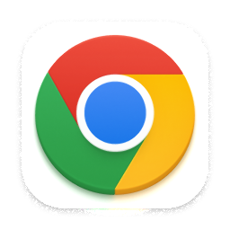
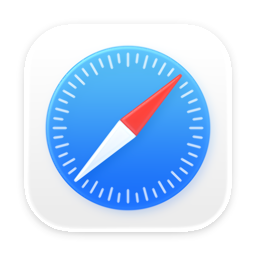
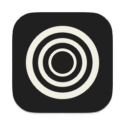

# Send to nvALT

A browser extension that sends the current page, the selection, or chosen
blocks to [nvALT](https://brettterpstra.com/projects/nvalt) as Markdown. These are based on the [Marked browser extensions](https://markedapp.com/extensions).

## Approved Extensions

Choose your browser. Chrome, Brave, and other Chromium browsers install from the Chrome Web Store. Firefox and Zen install from Mozilla Add-ons. Safari ships with nvALT.

<table>
  <tr>
    <td align="center" width="20%">
      <a href="https://chromewebstore.google.com/detail/send-to-nvalt/ojlofdmnooclkpekhldohicpdoojnnbh">
        <br>
        <b>Chrome</b><br>
        Install from the Chrome Web Store
      </a>
    </td>
    <td align="center" width="20%">
      <a href="https://addons.mozilla.org/en-US/firefox/addon/send-to-nvalt/">
        <br>
        <b>Firefox</b><br>
        Install from Mozilla Add-ons
      </a>
    </td>
    <td align="center" width="20%">
      <a href="#safari">
        <br>
        <b>Safari</b><br>
        View setup instructions
      </a>
    </td>
    <td align="center" width="20%">
      <a href="https://chromewebstore.google.com/detail/send-to-nvalt/ojlofdmnooclkpekhldohicpdoojnnbh">
        <br>
        <b>Brave</b><br>
        Install from the Chrome Web Store
      </a>
    </td>
    <td align="center" width="20%">
      <a href="https://addons.mozilla.org/en-US/firefox/addon/send-to-nvalt/">
        <br>
        <b>Zen</b><br>
        Install from Mozilla Add-ons
      </a>
    </td>
  </tr>
</table>

### Safari

To turn on the Safari extension:

1. Open nvALT so macOS can register the extension with Safari.
2. In Safari, choose Safari > Settings > Extensions.
3. Select **Send to nvALT** and turn it on.
4. Allow access to the websites you want to send. The extension needs access to the page you are viewing so it can read the page, the selection, or the blocks you choose.

If **Send to nvALT** does not appear in the list, quit Safari and open it again.


## Build

```bash
npm run build
```

This writes `dist/chrome` and `dist/firefox` (plus zip files in `dist/`).

## Test

```bash
npm test
```

This runs the Node tests.

## Chrome

1. Run `npm run build`.
2. Open `chrome://extensions` and turn on Developer mode.
3. Choose Load unpacked and select `dist/chrome`.

## Firefox

1. Run `npm run build`.
2. Open `about:debugging#/runtime/this-firefox`.
3. Choose Load Temporary Add-on and select `dist/firefox/manifest.json`.

## Safari

The Safari extension is embedded in nvALT. Turn it on in Safari Settings,
under Extensions.
